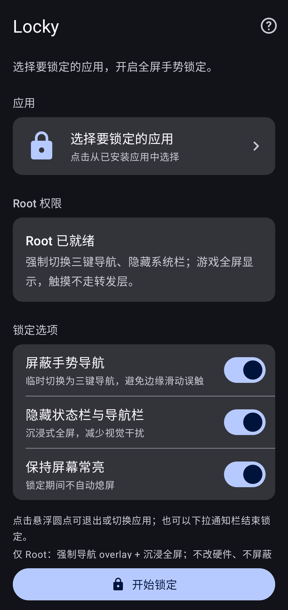
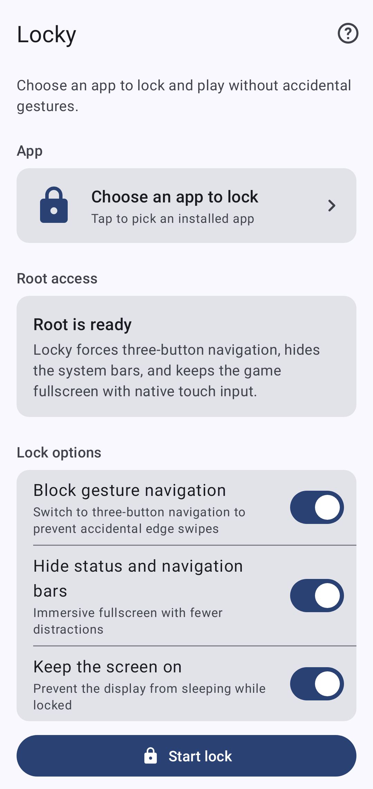
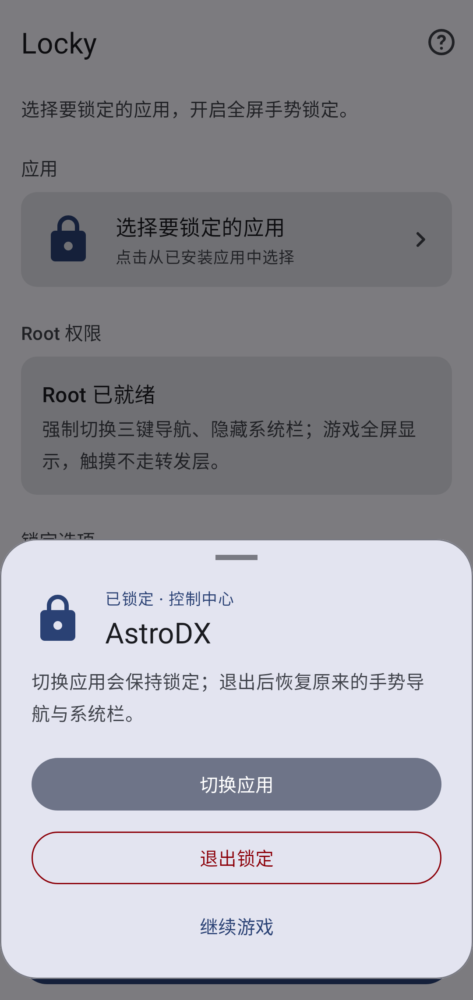

<div align="center">


# Locky

**Lock in. Play on.**  
Material 3 · Root 强制三键导航 + 沉浸全屏，把每一次触控都留给谱面。

Android 8.0+ · Material You · 仅 Root · English / 中文  
包名：`io.kernelxtra.activitylock`

[](https://github.com/rrrRex1336/ActivityLock/actions/workflows/android.yml)
[](https://github.com/rrrRex1336/ActivityLock/releases)

</div>

---

## 这是什么

一个给音游玩家用的「专注锁定」工具。选择一款已安装的游戏，点击开始后：

- 通过 **Root** 强制把系统导航 overlay 切换成**三键导航**，彻底丢掉边缘返回 / 上滑回桌面等手势；
- 可选**沉浸式隐藏状态栏与导航栏**，进入真正的全屏；
- 可选保持屏幕常亮；
- 目标游戏自动进入前台；游戏窗口**原生全屏渲染并直接接收全部触摸**；
- 一个可拖动的 **Material 3 悬浮圆点**：点击打开控制面板，一键退出或切换应用；
- 切换应用会保持锁定不中断，直接打开应用选择器；
- 退出时精确恢复原来的导航 overlay、导航模式与系统栏设置；
- 异常退出或设备重启后，下次打开应用 / 开机广播会自动恢复。

> 本项目只保留 Root 方案。普通 `navigation_mode` 设置在 HyperOS / 部分定制 ROM 上会被 SystemUI 忽略，所以要直接切换导航 overlay。  
> 电源键不在处理范围内，短按电源键仍会正常熄屏。

## 为什么不做「把 Activity 套一层再转发触摸」

把别的应用的 Activity 嵌进自己的窗口、再把触摸逐个转发过去，需要虚拟显示 + 注入输入事件：

- 会额外增加输入延迟，对音游是致命的；
- 跨应用 Activity 嵌入在普通应用中不可用，且 ROM 差异极大；
- 触摸转发容易形成事件循环或丢触点。

所以这里采用更可靠的方式：**不遮挡、不转发**。目标应用仍然是自己的原生全屏窗口，系统的手势导航在底层被 Root 关闭，触摸事件直接进入游戏。只有一枚可拖动的 48dp 悬浮圆点属于额外的悬浮窗。

## 视频

[](docs/Locky-Demo-Fun-16x9.mp4)

[▶ 观看 20 秒抽象快剪](docs/Locky-Demo-Fun-16x9.mp4) · 1920×1080 · 轻快电子乐 / 无旁白

[另一个 30 秒克制版](docs/Locky-Demo-16x9-1080p.mp4)

## 界面

| 主界面（浅色） | 主界面（深色） | English | 锁定控制面板 |
| --- | --- | --- | --- |
|  |  |  |  |

界面使用 Material Design 3 语义色与组件：`MaterialToolbar`、`MaterialCardView`、`MaterialSwitch`、`MaterialButton`、MD3 Bottom Sheet；Android 12+ 启用 Material You 动态取色，不支持时回退到 Material 3 默认色板。宽窗口内容限制在 640dp 内并居中，避免把平板界面拉成一条超宽设置页。

图标是自适应图标：普通模式为 Material 3 紫色锁 + 播放符号；Android 13+ 开启“主题图标”后，系统会用 monochrome 图层按壁纸主题自动着色。

## 多语言

- English（默认）
- 简体中文
- 跟随系统语言；Android 13+ 可在系统设置中单独为 Locky 选择语言。

新增语言只需在 `app/src/main/res/values-<locale>/strings.xml` 中补齐文案。

## 原理

```text
cmd overlay enable-exclusive --category com.android.internal.systemui.navbar.threebutton
settings put secure navigation_mode 0
settings put global policy_control immersive.full=*
```

1. 启动 `LockService` 前台服务，记录当前导航 overlay、`navigation_mode`、`policy_control`；
2. 通过 `su` 启用三键导航 overlay，并同步写入导航模式；
3. 写入沉浸式策略，进入全屏；
4. 启动目标游戏，保留一枚可拖动的 48dp 悬浮圆点；
5. 退出时切回原来的 overlay（例如 `navbar.gestural`），恢复导航模式、系统栏设置，并删除会话记录。

切换 overlay 比只写 `navigation_mode` 更底层，因此在这台 HyperOS/AOSP 混合 ROM 上验证有效。部分 ROM 在切换时会让 SystemUI 闪一下，这是系统行为。

## 安装

从 [GitHub Releases](https://github.com/rrrRex1336/ActivityLock/releases) 下载最新 APK：

```bash
adb install -r Locky-vX.Y.Z.apk
```

要求：

- Android 8.0（API 26）及以上；
- **Root**（Magisk / KernelSU / SukiSU 等）；
- 首次打开时，在 Root 管理器中允许「Locky」获得 Root；
- 首次点「开始锁定」时按系统提示允许通知权限。

## 使用

1. 打开应用，等待「Root 已就绪」；
2. 点击「锁定目标」选择音游；
3. 按需打开「屏蔽手势导航」「隐藏状态栏与导航栏」「保持屏幕常亮」；
4. 点「开始锁定」，游戏自动全屏打开；
5. 退出：点击左上角（可拖动）的悬浮圆点，直接点「退出锁定」；或下拉通知栏点「结束锁定」。
6. 切换：同一面板点「切换应用」打开应用选择器，选中后保持锁定并启动新应用。

如果 Root 状态显示未授权，点「请求 Root 权限」重新发起请求；应用会自动授予悬浮窗权限。

## 限制

- **必须 Root**，没有 ADB / Shizuku 兜底；
- 包名已从旧版 `com.rex.activitylock` 迁移到 `io.kernelxtra.activitylock`，升级需先卸载旧应用；
- 不是安全 kiosk，仍然可以通过通知栏或再次打开本应用手动退出；
- 电源键不会被屏蔽；
- 部分系统可能忽略 overlay 切换，应用会验证并拒绝启动，而不是假装成功；
- 游戏隐藏悬浮窗时，悬浮圆点不可用，请用通知栏退出；
- 切换导航 overlay 可能引起 SystemUI 短暂重启；
- 如果悬浮层初始化失败，服务会主动恢复原导航设置并退出，不会把你留在三键导航里。

## 从源码构建

环境：JDK 17、Android SDK Platform 35、Build Tools 35.0.0。

```bash
./gradlew testDebugUnitTest
./gradlew assembleDebug
```

输出：

```text
app/build/outputs/apk/debug/app-debug.apk
```

### 签名

Release 构建通过环境变量读取签名：

```bash
export ACTIVITYLOCK_KEYSTORE_FILE=/path/to/keystore.jks
export ACTIVITYLOCK_STORE_PASSWORD=...
export ACTIVITYLOCK_KEY_ALIAS=...
export ACTIVITYLOCK_KEY_PASSWORD=...
./gradlew assembleRelease
```

CI 使用同一套 GitHub Secrets 签名，保证后续版本可以覆盖安装。

### GitHub Actions

[`.github/workflows/android.yml`](.github/workflows/android.yml) 在 push / PR / 手动触发时：

1. 安装 JDK 17 与 Android SDK 35；
2. 运行单元测试；
3. 使用稳定签名构建 release APK；
4. 上传 `Locky` artifact。

推送 `v*` 标签会自动生成 GitHub Release 并附上 APK 与宣传片：

```bash
git tag v1.2.0
git push origin v1.2.0
```

## 项目结构

```text
app/src/main/java/io/kernelxtra/activitylock/
├── MainActivity.java                  # Material 3 主界面（仅 Root）
├── data/                              # 偏好、导航会话快照
├── service/
│   ├── LockService.java               # 前台锁定服务
│   ├── LockOverlay.java               # 悬浮圆点 / 控制面板
│   ├── QuickSwitchActivity.java       # 保持锁定切换目标应用
│   └── BootReceiver.java              # 重启恢复
├── system/SettingsController.java     # Root overlay / 系统设置切换与恢复
├── ui/                                # 应用选择器、适配器、响应式宽度
└── util/                              # su、已安装应用扫描
```

演示视频：DrawAI 画布 `video/Locky-Video.drawai` + Remotion 渲染，素材仅来自应用截图，无第三方游戏素材。

技术栈：Java 17、AndroidX、Material Components 3（`Theme.Material3.DayNight.NoActionBar`、Material You 动态色、`MaterialToolbar`、`MaterialCardView`、`MaterialButton`、`MaterialSwitch`、MD3 Bottom Sheet）。

## 隐私

- 不申请 `INTERNET` 权限；
- 不申请网络权限，不上传、不统计任何数据；
- Root 仅用于执行导航 overlay 和系统设置命令；
- 目标应用和配置只保存在本地。

## 许可

- 应用代码：[MIT License](LICENSE)
