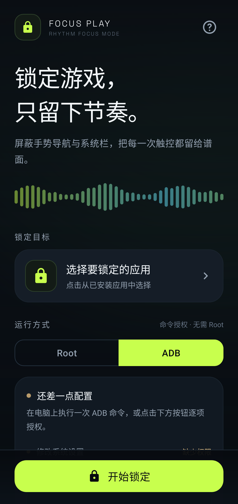
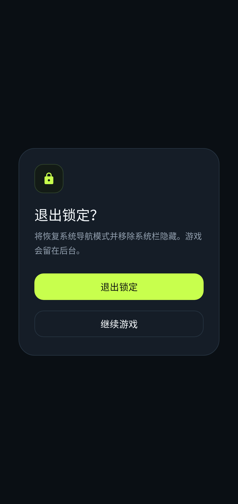

<div align="center">



# ActivityLock · 音游锁定

**屏蔽手势导航与系统栏，把每一次触控都留给谱面。**

Android 8.0+ · Material Design 3 · Root / ADB 两种授权方式

</div>

---

## 这是什么

一个给音游玩家用的「专注锁定」小工具。选择一款已安装的游戏，点击开始后：

- 自动把系统导航模式临时切换为**三键导航**，屏蔽边缘返回 / 上滑回桌面等手势；
- 可选**沉浸式隐藏状态栏和导航栏**，减少视觉干扰；
- 可选保持屏幕常亮；
- 目标游戏自动进入前台，悬浮条会短暂提示退出方式；
- 长按屏幕左上角小热区 1.5 秒即可退出，或下拉通知栏点击「结束锁定」；
- 退出后**恢复修改前的导航设置**，异常退出/重启后下次打开应用也会自动恢复。

> 电源键不在本项目的处理范围内，短按电源键仍会正常熄屏。
> 本项目不修改硬件按键映射，也不依赖 Xposed / LSPosed。

## 界面

| 主界面 | 退出确认 |
| --- | --- |
|  |  |

## 两种运行方式

两种方式最终使用同一套系统能力（`WRITE_SECURE_SETTINGS` + 悬浮窗），区别只是授权的过程：

| | Root 模式 | ADB 模式 |
| --- | --- | --- |
| 适合 | 已 Root（Magisk / KernelSU 等） | 未 Root，有电脑和数据线 |
| 配置 | 应用内点一次「一键 Root 授权」 | 在电脑执行两条 `adb shell` 命令 |
| 是否需要电脑 | 仅首次安装 APK 需要 | 授权和后续更新都需要可执行 adb |

需要修改的系统设置只有两项：

```text
Settings.Secure.navigation_mode = 0       # 临时切换到三键导航
Settings.Global.policy_control = immersive.full=*   # 隐藏系统栏
```

会话开始前会保存原值，退出时按原值恢复；如果进程被杀或设备重启，本应用下次启动或开机广播会执行恢复。

## 安装

从 [GitHub Releases](https://github.com/rrrRex1336/ActivityLock/releases) 下载最新 APK，或从 [Actions](https://github.com/rrrRex1336/ActivityLock/actions) 的构建产物中下载。

```bash
adb install -r ActivityLock-debug.apk
```

最低支持 Android 8.0（API 26），目标 API 35。

## 授权

### 方式一：ADB（无需 Root）

1. 安装并打开一次「音游锁定」；
2. 手机开启开发者选项和 USB 调试，连接电脑；
3. 执行：

```bash
adb shell pm grant com.rex.activitylock android.permission.WRITE_SECURE_SETTINGS
adb shell appops set com.rex.activitylock SYSTEM_ALERT_WINDOW allow
```

4. 回到应用，App 内也提供了「复制命令」和「检测授权」按钮。
5. 首次点「开始锁定」时按系统提示允许通知权限。

### 方式二：Root

1. 安装并打开应用；
2. 在「运行方式」中选择 **Root**；
3. 点击「一键 Root 授权」，在 Root 管理器中允许请求；
4. 应用会自动执行 `pm grant`、悬浮窗和通知授权。

如果已经用 ADB 授权过，切换到 Root 模式也不会重复弹 Root；两种方式可以混用。

## 使用

1. 点击「锁定目标」选择音游；
2. 按需打开「屏蔽手势导航」「隐藏系统栏」「保持屏幕常亮」；
3. 点「开始锁定」，游戏会自动打开；
4. 想退出时：
   - **长按屏幕左上角的小圆点热区 1.5 秒**，在确认框中退出；
   - 或下拉通知栏，点通知里的「结束锁定」；
   - 或回到本应用点「结束锁定」。
5. 退出后原来的导航模式会自动恢复。

## 它是怎么工作的

Android 没有给普通应用提供「屏蔽系统手势」的公开 API，因此本应用走的是 **系统设置覆盖 + 悬浮窗退出** 的方案：

1. `LockService` 作为前台服务启动，并记录原导航设置；
2. 写入 `navigation_mode=0` 与 `policy_control=immersive.full=*`；
3. 启动目标应用；
4. 用一个 44dp 的透明悬浮热区提供退出入口，不覆盖游戏其余画面；
5. 结束锁定或服务销毁时恢复设置，并清空会话标记，保证异常情况下也能恢复。

发布前会在 CI 上运行 Robolectric 界面冒烟测试（主界面、应用选择器、退出弹窗的资源 inflate），然后构建 debug APK。

## 限制（重要）

- **不是安全 kiosk**。用户仍然可以手动下拉通知栏、进入设置改导航方式，或者用电源键熄屏。这个应用解决的是「打歌时误触手势」，不是防沉迷/家长控制。
- 电源键**不会**被屏蔽。
- 不同 OEM 的导航模式实现不同。部分系统可能忽略 `navigation_mode` 设置，此时悬浮提示会显示「手势屏蔽未生效」，可以尝试只启用「隐藏系统栏」，或到系统设置手动改成三键导航。
- 切换导航模式时，部分设备会出现 SystemUI 短暂重启/闪烁，这是系统行为。
- 悬浮窗被游戏或系统隐藏时，无法用左上角退出；请使用通知栏的「结束锁定」。
- 如果系统杀掉了服务且没有执行 `onDestroy`，设置可能暂时保持；重新打开本应用会自动恢复。也可以重启设备，Boot Receiver 会恢复。

## 从源码构建

环境：JDK 17、Android SDK Platform 35、Build Tools 35.0.0。

```bash
./gradlew testDebugUnitTest
./gradlew assembleDebug
```

APK 输出：

```text
app/build/outputs/apk/debug/app-debug.apk
```

首次构建需要 Android SDK 许可；如果使用 Android Studio，直接打开项目即可。`local.properties` 不提交到仓库。

### GitHub Actions

[`.github/workflows/android.yml`](.github/workflows/android.yml) 会在 push / PR / 手动触发时：

1. 安装 JDK 17 与 Android SDK 35；
2. 运行单元测试；
3. 构建 debug APK；
4. 上传 `ActivityLock-debug` artifact。

推送 `v*` 标签时，还会自动创建 GitHub Release 并附上 APK，例如：

```bash
git tag v1.0.0
git push origin v1.0.0
```

## 项目结构

```text
app/src/main/java/com/rex/activitylock/
├── MainActivity.java              # Material 3 主界面
├── data/                          # 偏好设置、会话快照、应用列表模型
├── service/
│   ├── LockService.java           # 前台锁定服务
│   ├── LockOverlay.java           # 退出热区 / 提示 / 确认弹窗
│   └── BootReceiver.java          # 重启恢复
├── system/SettingsController.java # 读写/恢复系统设置，Root 兜底
├── ui/                            # 应用选择器、适配器、律动波形
└── util/                          # su 调用、已安装应用扫描
```

技术栈：Java 17、AndroidX、Material Components 3（`Theme.Material3.Dark.NoActionBar`）、`MaterialCardView`、`MaterialButton`、`MaterialSwitch`、`MaterialButtonToggleGroup`、MD3 Bottom Sheet。

## 隐私

- 不申请 `INTERNET` 权限；
- 不上传、不统计任何数据；
- 仅扫描可启动应用供你选择目标，选择结果保存在本地 SharedPreferences。

## 许可

- 应用代码：[MIT License](LICENSE)
- 字体 Space Grotesk：[SIL Open Font License 1.1](LICENSES_SpaceGrotesk_OFL.txt)
